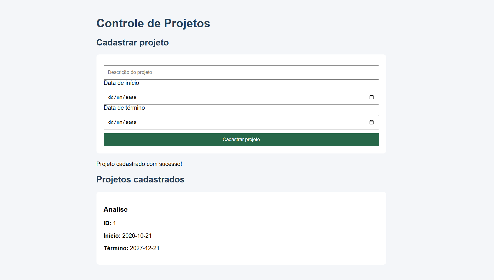

# Sistema de Controle de Projetos

## Sobre o projeto

Sistema desenvolvido com Spring Boot para o cadastro e gerenciamento de projetos, funcionários e setores.

## Tecnologias utilizadas

- Java
- Spring Boot
- Spring Data JPA
- H2 Database
- HTML, CSS e JavaScript
- Maven

## Tela do sistema

## Funcionalidades

- Cadastro e listagem de projetos.
- Cadastro de funcionários vinculados a setores.
- Associação de funcionários aos projetos.
- Consulta de projetos e setores.

## Como executar

1. Abra o projeto no VS Code.
2. Execute a classe principal da aplicação Spring Boot.
3. Acesse `http://localhost:8080` no navegador.

---

Projeto acadêmico desenvolvido para fins de aprendizado.
